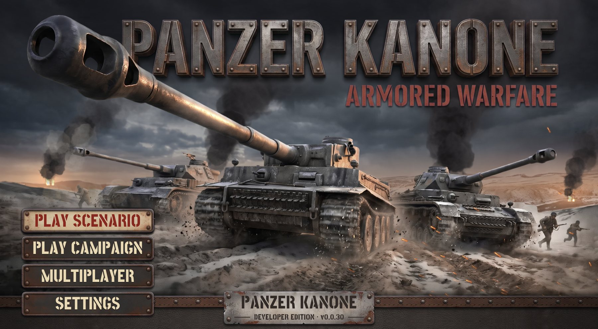
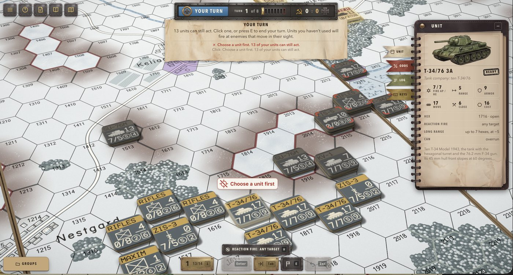
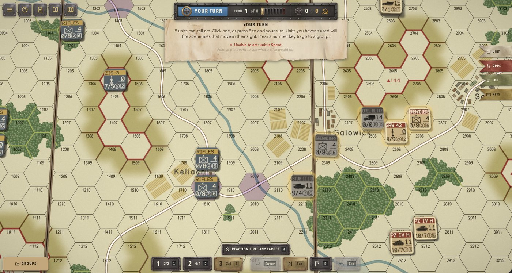
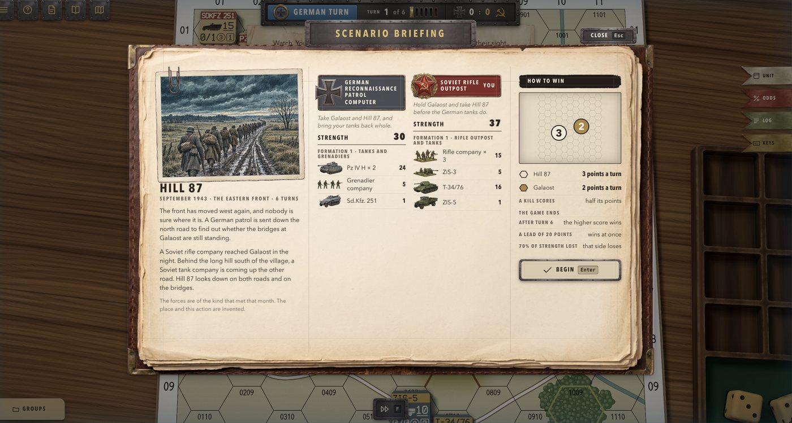
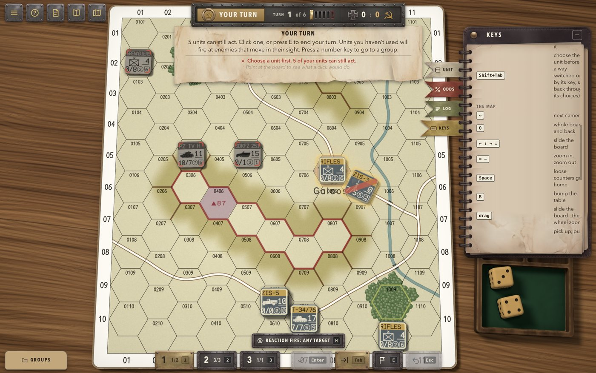
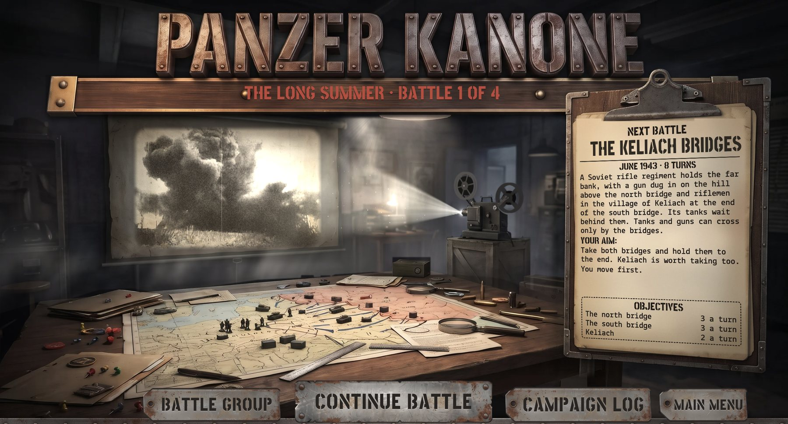
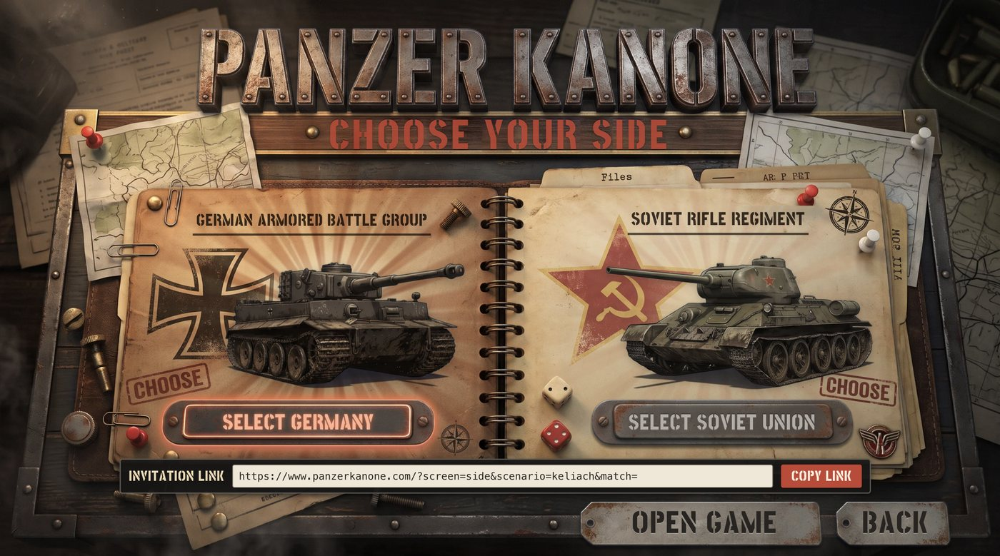
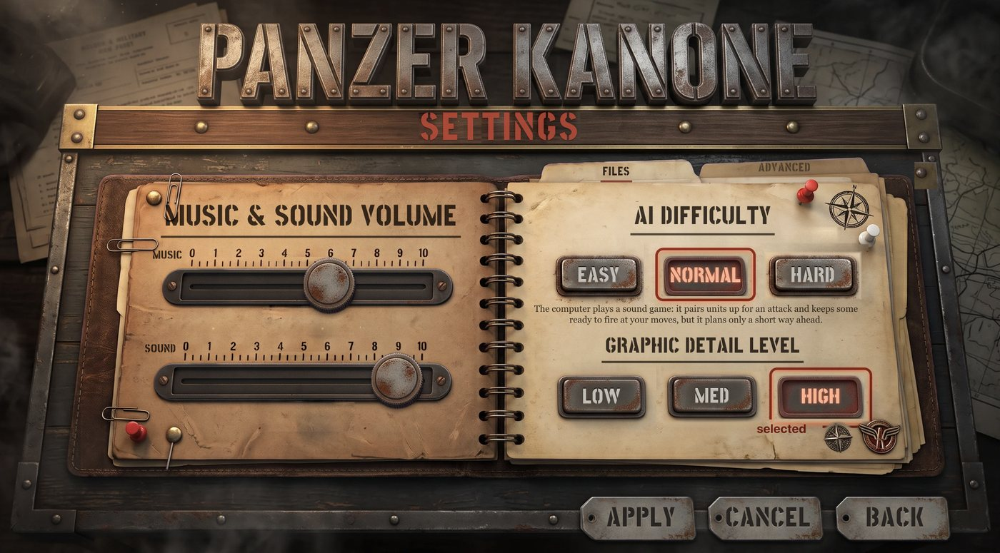

# Panzer Kanone



**Armored Warfare.** A tactical game of tank and infantry combat on the Eastern Front in 1943,
played in the browser on a 3D tabletop: a printed hex board, cardboard counters and dice, with a
field desk of steel and paper around them.

Play it at **https://panzerkanone.com**.

## Screenshots

<table>
  <tr>
    <td width="50%"><br><sub>Winter: the Soviet side's turn, the board tilted and a unit's card open.</sub></td>
    <td width="50%"><br><sub>Summer by the river at Keliach, the German side's turn.</sub></td>
  </tr>
  <tr>
    <td width="50%"><br><sub>Every battle opens with its briefing: the two forces, the objectives and how to win.</sub></td>
    <td width="50%"><br><sub>The board seen from above, with the keys panel open.</sub></td>
  </tr>
  <tr>
    <td colspan="2"><br><sub>A campaign's briefing room: the film on the screen, the next battle on the clipboard.</sub></td>
  </tr>
  <tr>
    <td width="50%"><br><sub>Choose a side; the link invites a second player online.</sub></td>
    <td width="50%"><br><sub>Settings: music and sound, the computer's skill, the graphics.</sub></td>
  </tr>
</table>

## The game

- You command a battle group of tank platoons, assault guns, infantry companies, anti-tank guns,
  mortars and their transport. Play against the computer, or two players at one screen.
- On your turn each of your units may do one thing: move, fire, close assault, overrun, mount or
  dismount, or call for artillery. A unit you leave alone stays ready and fires by itself at enemy
  units that move where it can see them.
- Tanks kill at range and can overrun infantry caught in the open. Infantry cannot hurt armor by
  fire, but two or three companies that close with a tank platoon will usually destroy it.
- Armor may make a short move and still fire, at a small penalty.
- Each side scores points every turn for the objectives it holds and for the enemy units it
  destroys. A side wins by a clear lead, by the higher score after the last turn, or when the
  other side breaks.

The game is an original design. It uses no board, scenario, counter, rule or table of any
published game.

(AI was used extensively and extravagantly, some might even say gratuitously to produce this multi-weekend project.
Claude, Nano-Banana, Codex, FAL, Comfy, Meshy, Suno, Eleven Labs. Claude Fable 5.2 ultracode running for about 5 hours
solving optics equations to produce realistic projector shader physics. etc.)

## Run it locally

You need Node.js 24 or newer.

```
npm ci
npm ci --prefix client
npm run dev
```

Open the address Vite prints. The game is at `/?view=table&game=1`.

`npm run build` makes a production build in `client/dist`, and `npm run typecheck` type-checks
everything.

## Versions

Every commit on `main` gets a version tag from the workflow in `.github/workflows/deploy.yml`: the
highest `vMAJOR.MINOR.PATCH` tag with its patch number one higher. The workflow writes that version
into `client/src/version.ts` before it builds, and the title screen shows it. A build made anywhere
else says `dev`. To start a new minor or major version, tag a commit by hand (`v0.1.0`); the patch
numbers go on from there.

## Layout

| Folder | What it holds |
|---|---|
| `client/` | The browser client: the 3D table (three.js), the interface, sound and battle effects |
| `engine/` | The rules engine: the hex grid, line of sight, the rules, and the computer opponent |
| `mapart/` | Draws a board from its description, the same way every time |
| `content/` | Game data: scenarios, unit types and the facts their values are derived from, the rules' numbers, the rule book |
| `assets/` | Art and sound, with an attribution ledger (`assets/LEDGER.yaml`) that has an entry for every file |

Game data is YAML or JSON and is checked when it is loaded. Randomness is seeded, so a game can be
replayed exactly.

## License

- Code: MIT. See `LICENSE`.
- The game's own art and content: CC BY 4.0. See `LICENSE-CONTENT.md`.
- Files from other makers keep their own terms. `assets/LEDGER.yaml` names the maker, the source
  and the license of every file.
